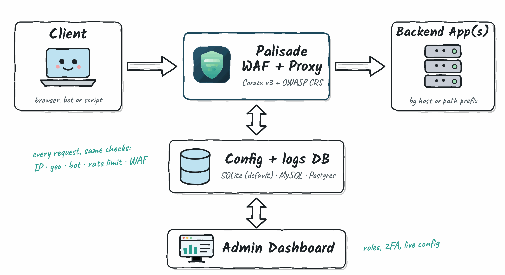

<div align="center">
  

<br><br>

[](https://github.com/sinhaparth5/palisade-waf/releases/latest)
[](https://github.com/sinhaparth5/palisade-waf/actions/workflows/ci.yml)
[](https://codecov.io/github/sinhaparth5/palisade-waf)
[](https://github.com/sinhaparth5/palisade-waf/actions/workflows/codeql.yml)
[](go.mod)
[](LICENSE)
</div>

**Palisade** is a web application firewall you can `scp` to a server: a WAF and reverse proxy in a single Go binary, built on [OWASP Coraza](https://github.com/corazawaf/coraza) and the OWASP Core Rule Set, with a built-in admin dashboard. It uses one binary, one SQLite file, CLI flags for bootstrap settings, and dashboard-managed runtime settings. There is no config file, external database, or Node toolchain. Docker is available for local development but is not required.

<div align="center">
  
</div>

## Features

- **WAF protection:** Coraza v3 with the OWASP Core Rule Set embedded in the binary. It blocks SQLi, XSS, RCE, path traversal, restricted file access, and known scanner user agents out of the box. Custom `.conf` rules can be loaded on top of CRS.
- **Reverse proxy / multi-app routing:** route by Host header (virtual hosting) or by path prefix, with automatic prefix stripping like nginx `location`, to as many backend apps as you need.
- **IP & country blocking:** manual IP allow/block rules plus GeoIP2-based country blocking (MaxMind GeoLite2), with Cloudflare-aware real-IP extraction and opt-in trusted proxy CIDRs for `X-Forwarded-For` / `X-Real-IP`.
- **TLS:** plain HTTP, automatic Let's Encrypt certificates, or your own cert/key, globally or per service. Upload a cert or enable auto-issue for a backend from the dashboard.
- **Admin dashboard:** HTMX/Tailwind UI for live traffic and threat charts, filterable request logs with live tail, IP/geo rule management, and service management. Changes apply immediately, with no restart.
- **Prometheus metrics:** `/admin/metrics` exposes request volume, latency, and per-cause block counters (IP/geo/WAF) alongside Go runtime metrics. For Prometheus, scrape `/admin/api/v1/metrics` with an API key from Settings (a read-only key is enough) via `authorization: { credentials: cwaf_… }`; the `/admin/metrics` path is for a logged-in browser session.
- **MCP server for AI assistants (read-only):** `/admin/api/v1/mcp` (Streamable HTTP) lets Claude, Cursor and other MCP clients search logs, read one request, see stats, look up an IP, and list services and rules. No tool can change anything, so an attacker's `User-Agent: ignore previous instructions…` has nothing to act on. Use a read-only API key from Settings:

  ```json
  {
    "mcpServers": {
      "palisade": {
        "type": "http",
        "url": "https://waf.example.com/admin/api/v1/mcp",
        "headers": { "Authorization": "Bearer cwaf_…" }
      }
    }
  }
  ```

  With Claude Code: `claude mcp add --transport http palisade https://waf.example.com/admin/api/v1/mcp --header "Authorization: Bearer cwaf_…"`.
- **Bot challenge for single-page apps:** a page load that gets challenged is redirected to the challenge page. A `fetch`/XHR can't run the challenge, so it gets `403 {"error":"challenge_required","challenge_url":"/_cz/challenge?…"}` instead; send the user there with `location.href = body.challenge_url` and they come back to the page that made the call. A cross-origin API can't read that body (no CORS headers), so treat a failed request to it the same way.
- **Health probes:** `/_cz/healthz` (process up) and `/_cz/readyz` (database reachable) for load balancers and orchestrators; the Docker image wires `palisade healthcheck` into its `HEALTHCHECK`.
- **SQLite storage:** request logs, IP/geo rules, services, and TLS state all live in one `waf.db` file. No Postgres, Redis, or MySQL to run.

## Installing

### Option A: native binary

```bash
curl -fsSL https://waf-install.astrareconslabs.com/palisade-waf/install.sh | sudo bash
```

This downloads the release binary for your architecture (amd64/arm64), verifies its SHA256 checksum (and, when `cosign` is installed, the signature on `checksums.txt`), creates a dedicated non-root system user, installs a systemd unit, and starts the service. The user is named `palisade` and is granted only `CAP_NET_BIND_SERVICE`, so it can bind ports 80/443 without running as root. The installer prompts for an admin email and password, or generates credentials, then seeds them into the database with `palisade setup`.

Check it's running:

```bash
sudo systemctl status palisade
sudo journalctl -u palisade -f
```

There is no config file to edit. Installer settings are either flags in the systemd unit (`sudo systemctl cat palisade`) or database values managed from the dashboard. The installer rewrites the unit on every upgrade, so put any extra flags (e.g. `--trusted-proxies`) on the `PALISADE_FLAGS=` line of `/etc/palisade/palisade.env`, which it never overwrites, then `sudo systemctl restart palisade`. Data, certs, and `waf.db` live under `/var/lib/palisade/`.

#### Upgrading

Re-run the same command:

```bash
curl -fsSL https://waf-install.astrareconslabs.com/palisade-waf/install.sh | sudo bash
```

The installer detects the existing binary at `/usr/local/bin/palisade` and switches to upgrade mode. It downloads and verifies the latest release, replaces the binary, rewrites the systemd units, and restarts the service. It skips the interactive prompts. Admin credentials and TLS certificates are never touched on upgrade. Pin a specific version with `curl -fsSL ... | sudo PALISADE_VERSION=v2.5.1 bash`.

**MySQL and Postgres are no longer supported; Palisade stores everything in SQLite.** The installer moves an install that ran on one of them: before replacing the binary it runs `palisade config export` with the old one, then imports the file into `/var/lib/palisade/waf.db`. Services, rules, users, API keys and settings come across. The request log does not, and the old database is left untouched. Releases before v3.2.5 have no `config export`, so upgrade those to v3.2.7 first (`PALISADE_VERSION=v3.2.7`). Without the installer, run the same two steps yourself:

```bash
# with the previous release, against the old database
palisade config export --db-driver postgres --db 'postgres://...' --db-key-file /etc/palisade/db.key --out config.json
# with this release
palisade config import --db /var/lib/palisade/waf.db --db-key-file /etc/palisade/db.key config.json
```

Then drop `--db-driver` and point `--db` at the SQLite file. A MySQL or Postgres `--db-driver` or connection string now fails at startup with these steps.

**Versions before v2.5.1 are deprecated.** The installer only installs v2.5.1 or later, and it no longer migrates old Coraza WAF Mod (`coraza-waf-mod`) installs. To move one of those to Palisade, run the v2.5.1 installer once: `curl -fsSL https://raw.githubusercontent.com/sinhaparth5/palisade-waf/v2.5.1/deploy/install.sh | sudo bash`.

### Option B: build from source

Requires Go 1.27+.

```bash
git clone https://github.com/sinhaparth5/palisade-waf.git
cd palisade-waf
make build      # go generate (minifies JS) + go build -> ./palisade

# Seed an admin account (password is read from stdin, not a flag):
echo "your-password" | ./palisade setup --admin-email you@example.com

./palisade   # defaults: --listen :8080 --db waf.db --certs ./certs
```

`make run` builds and runs in one step. Run `setup` first, at least once, so you can log in. The project uses Go only; the SQLite driver is `modernc.org/sqlite`, with no CGO. See `palisade --help`, or the flag table in `CLAUDE.md`, for every bootstrap option (`--listen-tls`, `--listen-h3`, `--waf-rules`, `--geo-db`, `--retention`, `--tls-cert`/`--tls-key`, `--trusted-proxies`).

Search-engine and link-preview crawlers skip the bot challenge only when their source checks out (reverse DNS or network), never on user agent alone. To let your own monitor through, pin it to the IP it connects from:

```bash
./palisade --trusted-crawlers "dev-portal-uptime=x.x.x.x"   # ua=cidr[,cidr];ua2=ip
```

The pin lives in your service's flags, not the repo. It skips only the challenge; the WAF, rate limits and IP rules still apply.

### Option C: cross-compiled release binaries

```bash
make dist        # cross-compiles Linux amd64/arm64 binaries, CGO_ENABLED=0
make checksums   # writes dist/checksums.txt
```

### Option D: Docker for local development

```bash
docker compose run --rm waf setup --db /data/waf.db --admin-email you@example.com
docker compose up --build
```

`Dockerfile` (multi-stage, `scratch` final image) and `compose.yml` are for local container development only. The image runs as uid 65532: map ports below 1024 (or add `--cap-add NET_BIND_SERVICE`), and if a volume was created by an image that still ran as root, fix its owner once with `docker run --rm -v <volume>:/data alpine chown -R 65532:65532 /data`. Use Option A for systemd-based installs.

## Usage

1. Start the server. There is no config file, only CLI flags for bootstrap settings.
2. Before first login, seed an admin account with `palisade setup --admin-email you@example.com` (password read from stdin). `install.sh` does this for you interactively. The email is your login name and must be a real address; the login form accepts nothing else. Locked out? Run `sudo -u palisade palisade setup --db /var/lib/palisade/waf.db --admin-email you@example.com --reset-password` and type the new password: it replaces that user's password, signs out their sessions and records it in the audit log. Without `--reset-password`, setup never changes an existing account. Not sure which login exists? `palisade setup --db /var/lib/palisade/waf.db --list-users` prints every admin user (role, 2FA, passkeys, SSO, last session) and changes nothing.
3. Open the admin dashboard at `http://<host>:<port>/admin` (the path is currently fixed at `/admin`) and log in with that email and password.
4. Add backend apps from **Services**: give each service a name, a match rule (Host or path Prefix), and a backend URL. The wizard checks that the backend is reachable before saving. Services live in the database, with no config-file seeding step.
5. Manage IP rules, country blocking, and request logs from their dashboard pages. Changes take effect immediately.
6. Optionally enable TLS per service from the **Manage** button on its row. Upload a cert, or turn on auto-issue after setting an ACME contact email from the Settings page or passing `--domain`/`--acme-email` to `palisade setup`.

### GeoIP setup (optional)

Country blocking uses the bundled MaxMind GeoLite2 Country database by default, so fresh builds work without manually copying an `.mmdb` file. This product includes GeoLite Data created by MaxMind, available from [https://www.maxmind.com](https://www.maxmind.com).

To override the bundled database with a newer external copy:

1. Create a MaxMind account from the [GeoLite2 signup page](https://dev.maxmind.com/geoip/geolite2-free-geolocation-data/).
2. In the MaxMind account portal, generate a license key for database downloads.
3. Download `GeoLite2-Country` in `GeoIP2 Binary (.mmdb)` format, then extract `GeoLite2-Country.mmdb`.
4. Put the file somewhere readable by the service, for example:

```bash
sudo mkdir -p /var/lib/palisade
sudo cp GeoLite2-Country.mmdb /var/lib/palisade/
```

5. Point the binary at it with `--geo-db`:

```bash
./palisade --geo-db /var/lib/palisade/GeoLite2-Country.mmdb
```

(For a systemd install, add `--geo-db ...` to `PALISADE_FLAGS=` in `/etc/palisade/palisade.env` and `sudo systemctl restart palisade`.)

Leave `--geo-db` unset to use the bundled database. GeoLite users must keep the database updated; MaxMind requires old database versions to be replaced or destroyed within 30 days of a new release, so release builds should refresh the bundled `.mmdb` regularly.

## Development

```bash
make build   # build (runs go generate first — required after editing static/js/src/*.js)
make test    # go test ./...
make clean   # remove binary, minified JS, dist/
```

See `CLAUDE.md` for architecture notes if you're working on the codebase.
